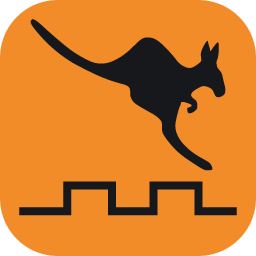
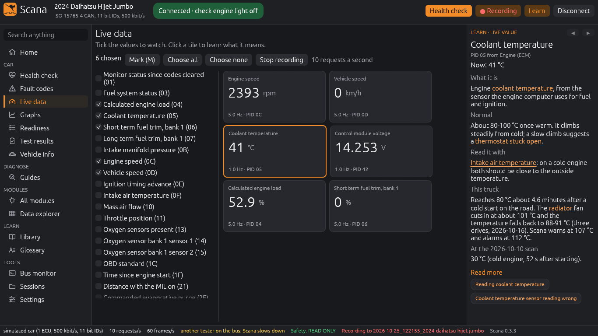
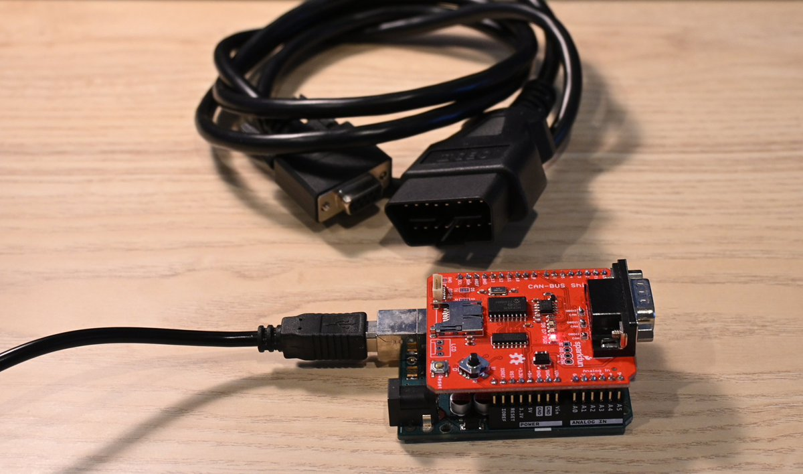
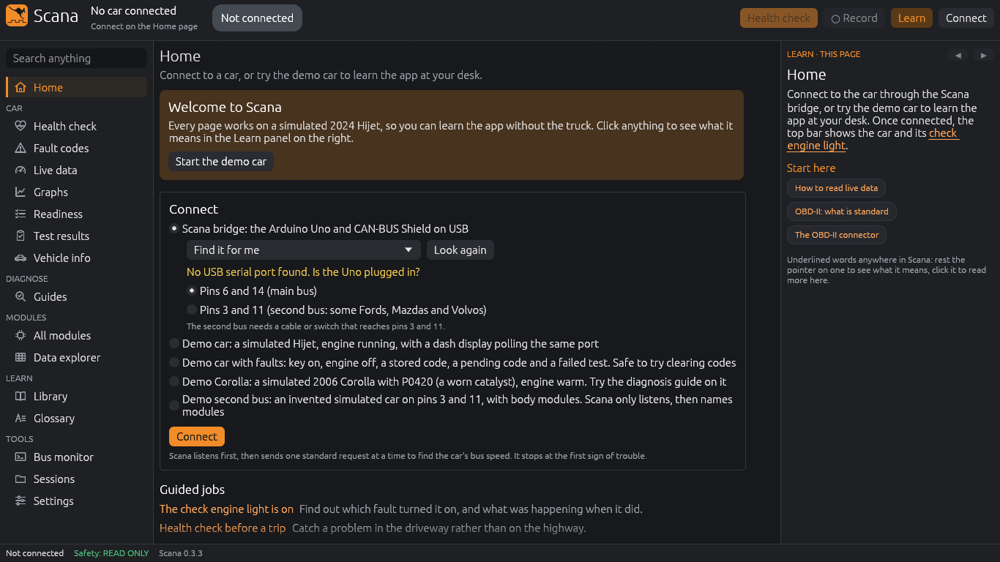
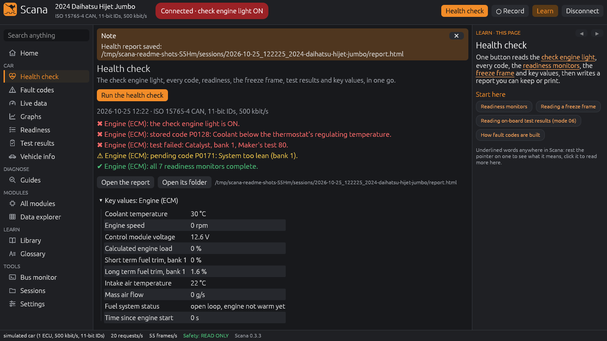
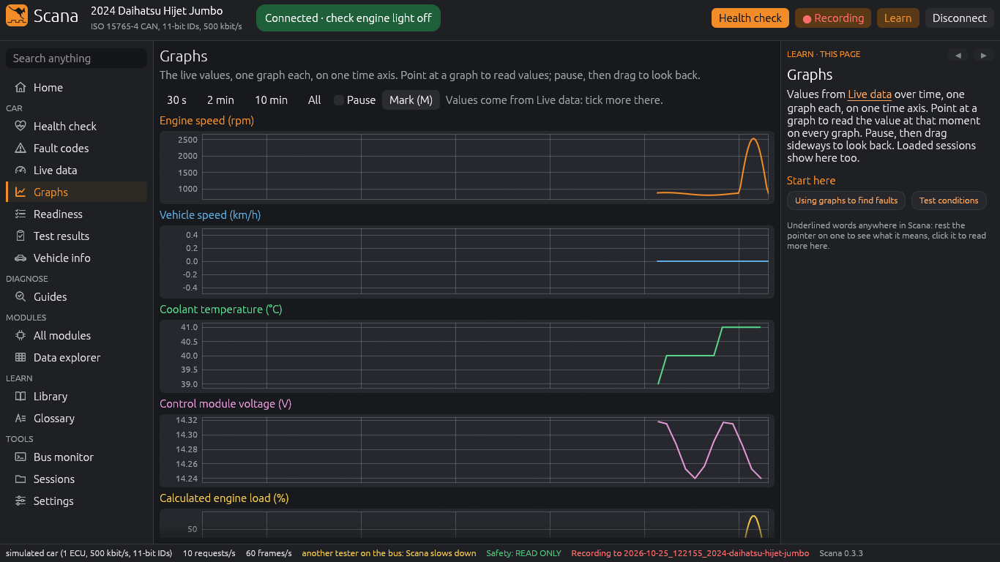
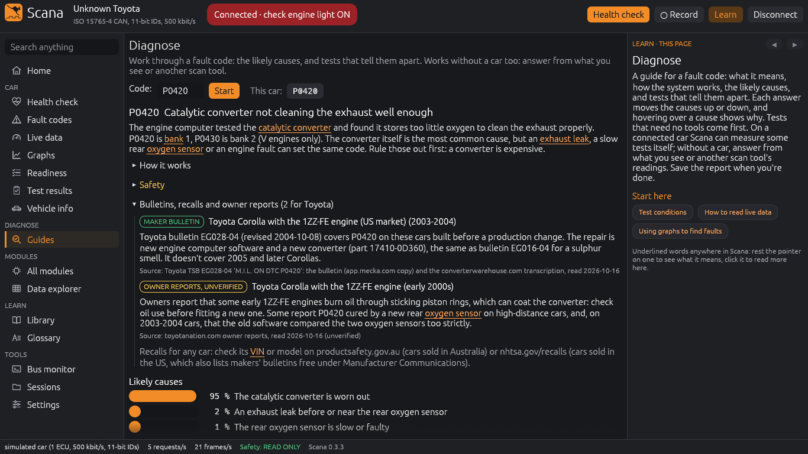
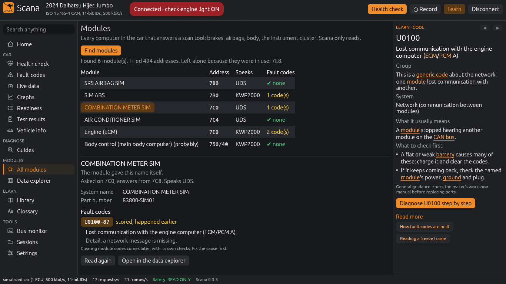
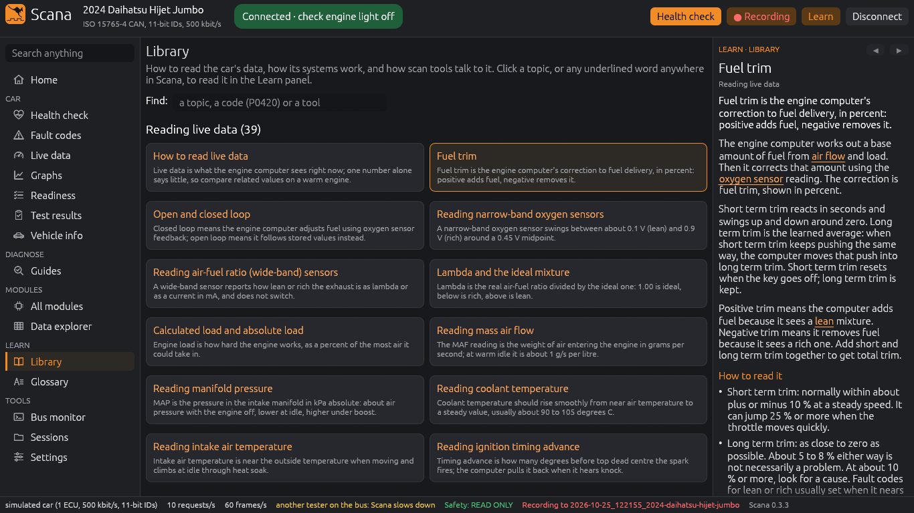

<p align="center"></p>

# Scana

Scana is a scan tool for cars. It runs on a Linux laptop.

Scana connects to the car through a small USB bridge: an Arduino Uno with a CAN shield.

Scana reads data from the car. It does not change the car. The only exception is when you clear fault codes.



## What Scana does

- Shows live data: engine speed, temperatures, fuel trims and more.
- Shows graphs of live data.
- Reads fault codes and freeze frames, and tells you what they mean.
- Does a health check and saves a report.
- Finds the modules in the car (ABS, airbag, body) and reads their codes.
- Gives step-by-step guides to find the cause of common fault codes.
- Records a drive to files.
- Explains each value and word. Put the pointer on an underlined word to see what it means.

## What you need

| Item | Notes |
|---|---|
| Arduino Uno R3 | A genuine Uno, or a clone with an ATmega16U2 USB chip |
| SparkFun CAN-BUS Shield (DEV-13262) | Keep the DB9 jumpers on the OBD-II setting. This is the default |
| OBD-II to DB9 cable | SparkFun CAB-10087, or a cable with the same wiring |
| USB cable | USB-A to USB-B, for the Uno |
| Laptop with Linux | Screen 1366 x 768 or larger |



*The bridge (front): the Uno with the CAN shield. The OBD-II to DB9 cable (back).*

## Cars that Scana can read

- Cars with OBD-II on CAN (ISO 15765-4), at 500 or 250 kbit/s, with 11-bit or 29-bit IDs.
- A second CAN bus on OBD-II pins 3 and 11 (some Ford, Mazda and Volvo cars). This needs a special cable. See [The second bus](#the-second-bus-pins-3-and-11).

Scana cannot read K-line (ISO 9141, ISO 14230), J1850 or CAN FD.

To find out if a car uses CAN:

- Look in the car's OBD-II socket. CAN uses pins 6 and 14. If there are no metal contacts at pins 6 and 14, the car does not use CAN.
- Or connect another scan tool. "ISO 15765-4" is CAN.

## Install

1. Install Rust 1.99 or newer from [rustup.rs](https://rustup.rs).
2. Install [arduino-cli](https://arduino.github.io/arduino-cli/). Then install the AVR core:

   ```
   arduino-cli core install arduino:avr
   ```

3. Get the code:

   ```
   git clone https://github.com/Azzadog11/scana
   cd scana
   ```

4. Build Scana:

   ```
   cargo build --release
   ```

   The programs are in `target/release`: `scana-app` is the app, and `scana` is the command line.

5. Give your user access to the serial port. Then log out and log in again.

   ```
   sudo usermod -aG uucp $USER      # Arch, CachyOS, Manjaro
   sudo usermod -aG dialout $USER   # Debian, Ubuntu, Fedora
   ```

## Load the bridge firmware

Do these steps one time.

1. Put the shield on the Uno.
2. Connect the Uno to the laptop with the USB cable.
3. Find the port of the Uno:

   ```
   ./target/release/scana ports
   ```

4. Compile and load the firmware. Use the port from step 3:

   ```
   arduino-cli compile --fqbn arduino:avr:uno --upload -p /dev/ttyACM0 firmware/scana-bridge
   ```

5. Test the bridge:

   ```
   ./target/release/scana probe
   ```

   The result must show `Self-test: PASS`.

## Try Scana without a car

Scana has simulated cars. You do not need the bridge.

- The app: run `./target/release/scana-app --demo`. Or start the app and click **Start the demo car**.
- The command line: run `./target/release/scana --sim health`.

More simulated cars: `--sim-corolla`, `--sim-car ute-diesel`, `--sim-car hatch-two-ecus` and `--sim-car hybrid`.

## Connect to a car

> **WARNING:** Do not use the laptop while you drive. A passenger must use the laptop.
>
> Keep the cables away from the pedals. Put the laptop where it cannot move.

1. Find the OBD-II socket. It is usually below the dashboard, near the steering wheel.
2. Turn the ignition on. The engine can be on or off.
3. Connect the cable to the shield and to the OBD-II socket.
4. Connect the Uno to the laptop.
5. Start `scana-app`.
6. On the **Home** page, select **Scana bridge** and **Pins 6 and 14 (main bus)**.
7. Click **Connect**.
8. Wait until the top bar shows **Connected**.



*The Home page. The yellow line shows when the Uno is not connected.*

## Use the app

| Page | Use it to |
|---|---|
| **Health check** | Do a full check. Scana saves a report. |
| **Fault codes** | Read stored, pending and permanent codes. |
| **Live data** | See values now. Tick the values to show. |
| **Graphs** | See values over time. |
| **Readiness** | See which emission tests are complete. |
| **Guides** | Find the cause of a fault code, step by step. |
| **All modules** | Find the modules and read their codes. Do this only when the car is parked. |
| **Library** | Read about live data, car systems and CAN. |
| **Bus monitor** | See all the frames on the bus. |
| **Sessions** | Open recordings and reports. |

To record a drive: open **Live data**, click **Choose all**, then click **Record**.

| | |
|---|---|
|  |  |
| **Health check** | **Graphs** |
|  |  |
| **Guides** (simulated car) | **All modules** (simulated car) |



## Use the command line

| Command | What it does |
|---|---|
| `scana probe` | Tests the bridge. |
| `scana detect` | Finds the bus and the computers in the car. |
| `scana health` | Does a health check and saves a report. |
| `scana codes` | Reads the fault codes. |
| `scana pids` | Reads the live data. |
| `scana record` | Records all live values. Press Enter to stop. |
| `scana modules` | Finds the modules. Do this only when the car is parked. |
| `scana diagnose P0420` | Shows a step-by-step guide for a fault code. |
| `scana explain fuel trim` | Explains a fault code or a word. |
| `scana clear` | Clears the fault codes. Scana asks first. |

Run `scana --help` to see all the commands.

## Safety

- Scana only reads. The only exception is when you clear fault codes.
- Before Scana clears codes, it asks you. Then it saves a report. It clears codes only when the engine is off and the car is stopped.
- Scana does not program, code or unlock a computer in the car.
- Scana finds modules only when the car is stopped.
- Use Scana at your own risk. See the licence.

## The second bus (pins 3 and 11)

Some Ford, Mazda and Volvo cars have a second CAN bus on pins 3 and 11. The body modules use this bus.

You need a cable or a switch that connects these pins to the shield:

| OBD-II pin | Signal | Shield DB9 pin |
|---|---|---|
| 3 | CAN high | 3 |
| 11 | CAN low | 5 |
| 4 | Ground | 2 |

To use the second bus:

- The app: on the **Home** page, select **Pins 3 and 11**.
- The command line: add `--pins 3-11`, for example `scana --pins 3-11 detect`.

On this bus, Scana only listens. It sends requests only after you confirm that the car is parked.

## Status

- Version 0.3.3. Bridge firmware 0.1.2.
- Tested in one car: a 2024 Daihatsu Hijet.
- Other features are tested only with simulated cars.
- Expect some problems.

## For developers

| File | Contents |
|---|---|
| `docs/DESIGN.md` | How Scana works: the firmware, the protocol, the crates and the safety rules. |
| `CLAUDE.md` | The rules for changes to the code. |
| `tools/gate.sh` | Runs the format check, the lint, the tests and the firmware checks. |

## Credits

- The kangaroo in the logo is "Jumping kangaroo" from OpenClipart (public domain, CC0).
- Most module addresses come from openpilot's [opendbc](https://github.com/commaai/opendbc) (MIT licence).

## Licence

Scana is free software under the GNU General Public License, version 3 or later. See `LICENSE`.

You can use, study, change and share Scana. If you share a changed version, you must share its source under the same licence.
